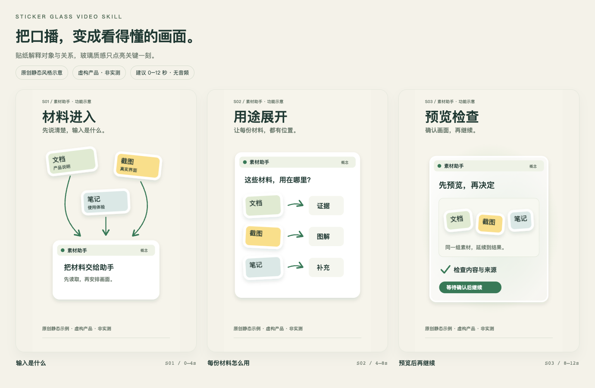

# Sticker Glass Video Skill

**Turn a spoken explanation into a clear visual story: stickers explain; glass adds emphasis.**

[简体中文](README.md) · [Download skill ZIP](https://github.com/alleinDuck/sticker-glass-video-skill/releases/latest/download/ai-sticker-glass-video.zip) · [Repository ZIP](https://github.com/alleinDuck/sticker-glass-video-skill/archive/refs/heads/main.zip) · [Skill](skills/ai-sticker-glass-video/SKILL.md) · [MIT License](LICENSE)



The image is an original static illustration with a fictional product and synthetic copy. It demonstrates the visual approach, not a real product test or a guaranteed video output.

## What it does

An Agent Skill for AI tool explainers and technology videos. It turns source video, SRT subtitles, and optional supporting materials into a staged production workflow:

**Read inputs → draft a tailored production prompt → create a static review package → get approval → render and check the video.**

- Light backgrounds, white-bordered stickers, short labels, arrows, and close-ups.
- Subtle gradients and glass treatment for product reveals and window layers.
- Consistent objects and relationships across scenes.
- Real screenshots and recordings as evidence; explicit labels for conceptual diagrams.
- Original audio preserved by default, with a reviewed subtitle plan.

The skill supplies instructions and references. Your agent and its configured tools perform media inspection, graphics creation, rendering, and verification.

## Install

With Node.js 22.20+ and the [skills CLI](https://github.com/vercel-labs/skills):

```bash
npx skills add alleinDuck/sticker-glass-video-skill --skill ai-sticker-glass-video
```

Install for Codex in the current project:

```bash
npx skills add alleinDuck/sticker-glass-video-skill --skill ai-sticker-glass-video -a codex
```

Add `-g` for a global installation. Use `-a claude-code` or `-a cursor` for other agents. The installer supports those agents; end-to-end media production has not been verified in every agent.

Alternatively, [download the skill ZIP](https://github.com/alleinDuck/sticker-glass-video-skill/releases/latest/download/ai-sticker-glass-video.zip) and copy the entire extracted `ai-sticker-glass-video/` folder into your agent's skill directory. In the full repository archive, find that folder under `skills/`. Keep `references/`, `agents/`, and `LICENSE` alongside `SKILL.md`. See the [agent path reference](https://github.com/vercel-labs/skills/blob/main/docs/agents.md). Back up customizations before updating.

## Requirements

Use an agent with local file access, terminal tools, and media inspection capabilities. FFmpeg / ffprobe and a browser or static renderer are typical supporting tools. Video export requires a separately configured renderer, such as HyperFrames or Remotion. Network access is useful for checking official sources.

No renderer, model subscription, API credentials, or third-party media is bundled. The optional `agents/openai.yaml` file supplies Codex UI metadata. Instructions default to Simplified Chinese; you can explicitly request another output language.

## Use

### 1. Supply source material

Replace these example paths with your files:

```text
Use $ai-sticker-glass-video.
Video: /path/to/project/demo.mp4
Subtitles: /path/to/project/demo.srt
Brief: /path/to/project/brief.md — use only the positioning and feature-one sections.
Screenshot: /path/to/project/screenshot.png — use it to demonstrate the feature.

Read the materials and produce a tailored production prompt first.
Use the sticker explainer style with glass accents and preserve the original audio.
```

`$skill-name` is the Codex invocation syntax. In another agent, use its skill selector or mention the skill name.

### 2. Request the static review package

```text
Proceed with that prompt. Create the full static storyboard, detailed scene plan,
asset mapping, source table, and representative keyframes. Wait for my design approval.
```

Expected files:

| File | Contents |
| --- | --- |
| `storyboard.html` | Full visual coverage with layout, copy, timing, actions, and asset IDs |
| `STORYBOARD.md` | Input checks, timed scenes, asset mapping, audio/subtitle plan, open questions |
| `素材来源表.md` | Sources, local paths, usage, scene mapping, availability, and evidence boundaries |
| `关键帧-XX.png` and `关键帧对照.png` | Representative high-resolution stills and a comparison sheet |

### 3. Approve and render

```text
I approve review version v1. Produce the video from that version.
Preserve the original audio. Check mobile readability, subtitle visibility,
transitions, audio alignment, and the ending. Deliver the MP4, editable project
with assets, updated source table, and verification notes.
```

Approval applies to the reviewed version. Material changes to content or visuals should be reflected in a revised review package.

## Example and limits

Open [examples/storyboard.html](examples/storyboard.html) locally after downloading. The [scene plan](examples/STORYBOARD.md) and [source table](examples/素材来源表.md) explain the original three-scene example.

The example is static, with suggested timing and no audio or MP4. It demonstrates style and review structure. It does not validate any rendering engine or audio synchronization.

Text-only input can be used for explicitly requested static designs or silent inserts. Without source audio, word-level timing cannot be verified. Missing product evidence must be represented as a labeled concept, not a fabricated test result. Third-party media and tool licenses remain separate.

Release checks cover skill structure, local references, installer discovery, installed file integrity, and static example rendering. Full production on other agents and renderers requires validation in those environments.

## Contribute and license

See [CONTRIBUTING.md](CONTRIBUTING.md) for issue and contribution guidelines. Original instructions, documentation, and examples are provided under the [MIT License](LICENSE).

Format reference: [Agent Skills specification](https://agentskills.io/specification).
